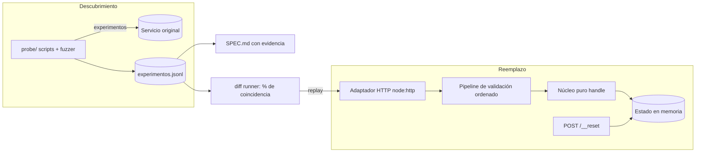

# Caja negra · Documento de diseño

**Autor:** Gabriel Ramos · Frontier Bogotá 2026 · Reto 2

## Problema
Un servicio sin código ni documentación recibe mensajes `COMANDO;args;control` por `POST /msg` y mantiene
estado (cuentas, saldos, operaciones). Hay que construir un reemplazo que responda exactamente igual
(status y cuerpo), errores incluidos, y documentarlo para que otro ingeniero lo pueda reimplementar.

## Enfoque: el original es el oráculo
1. **Experimentos con hipótesis.** Scripts propios (`probe/`) mandan requests controlados al original y
   registran cada uno en `experimentos.jsonl` con su hipótesis y conclusión. Límite propio de 5 req/s y
   control del presupuesto diario (8.000 req).
2. **Especificación con evidencia.** Cada comportamiento en `SPEC.md` tiene un ID, cita las líneas del log
   que lo prueban y su nivel de confianza (confirmado / probable / supuesto).
3. **Testing diferencial.** `probe/diff.ts` reproduce las secuencias grabadas contra el reemplazo local y
   mide el % de respuestas idénticas por comando. Ese % guía qué implementar después.
4. **Detección de cambios.** `probe/drift.ts` re-ejecuta una secuencia canaria contra el original durante
   el día para detectar cambios de versión (se evalúa contra la versión de las 20:00).

## Arquitectura del reemplazo
- **Núcleo funcional puro:** `handle(state, request) -> { state, status, body }`. Sin red, sin reloj.
  `POST /__reset` = `state = initialState()`. Determinista y testeable sin servidor.
- **Pipeline de validación con orden explícito:** ruta → autenticación → JSON → campo `m` → control
  (formato y valor) → comando → aridad → reglas de negocio. El orden replica el del original y está
  documentado en la sección 5 de la especificación.
- **Checksum aislado** (`checksum.ts`), probado contra todos los pares conocidos.
- **Estado en memoria:** cuentas, saldos, operaciones (para anular), contadores de IDs (`AC-0001`, `OP-0001`).
- **Adaptador HTTP delgado** con `node:http` (Node 24, sin dependencias en runtime).

## Despliegue
Un solo proceso (el estado vive en memoria) en un servicio con URL pública, `GET /health`, auth por
`Bearer` con el token del equipo y un ping periódico para que no se duerma (cada paso tiene 5 s).

## Riesgos y mitigación
| Riesgo | Mitigación |
|---|---|
| No descifrar el algoritmo del control | Experimentos de un solo carácter de diferencia usando el original como oráculo |
| El servicio cambia durante el día | Secuencia canaria periódica + sección 6 de la spec |
| Afirmaciones falsas en la spec restan | Solo "confirmado" con evidencia repetida; lo demás, "probable" o "supuesto" |
| Instancia dormida o múltiple | Un solo proceso + keep-alive |

## Diagrama

