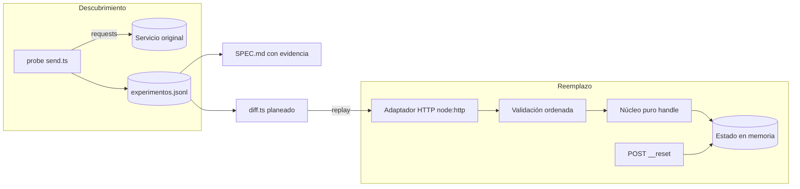

# Caja negra · Documento de diseño

**Autor:** Gabriel Ramos · Frontier Bogotá 2026 · Reto 2

## Problema
Un servicio sin código ni documentación recibe mensajes `COMANDO;args;control` por `POST /msg` y guarda
estado (cuentas, saldos, operaciones). Hay que construir un reemplazo que devuelva el mismo status y el mismo
cuerpo, errores incluidos, y una especificación que permita reimplementarlo sin tocar el original.

## Enfoque: el original es el oráculo
1. **Experimentos con hipótesis** (hecho). `probe/send.ts` manda cada request al original y la registra en
   `experimentos.jsonl` con hipótesis y conclusión. Límite propio de 5 req/s y presupuesto de 8.000/día en `probe/budget.json`.
2. **Especificación con evidencia** (por escribir). `SPEC.md`: ID, comportamiento, ids del log y confianza.
3. **Testing diferencial** (planeado, no construido). `probe/diff.ts` reproducirá las secuencias grabadas contra el reemplazo local.
4. **Detección de cambios** (planeado, no construido). `probe/drift.ts` re-ejecutará una secuencia canaria contra el original.

## Lo que ya sabemos
Orden de validación observado; los números son ids de `experimentos.jsonl`:

`404 E404` (24–26) → `401 E001` (27, 28) → `400 E100` (29) → `E102` (30) → `E103` (31, 39) → `E201` (18) →
`E202` (3) → `E301` (13, 50) → `E302` (21) → negocio: `404 E401` (16), `422 E506` (10), `422 E507` (17).

- **Confirmado:** la ruta va antes que la autenticación (33, 34). La autenticación va antes que el JSON (35). El control va antes que el comando (41, 51) y antes que la aridad (42).
- **E102 también cubre `m` no string:** con `m` = 123, null o array (36–38). E101 no se ha observado.
- **Fuera de la lista:** `PING;` da `E104 segmento vacío` (40). Su posición frente a E201/E202 está **por confirmar**.
- **Hipótesis:** E201 antes que E202 (solo una observación de cada uno) y E302 antes que los errores de negocio (no probado).
- **Header `X-Req`:** es un contador que **no se reinicia con `/__reset`** (probable; ids 36, 52). Sube con cada `POST /msg` autenticado y viene vacío en `/__reset`, `/health`, 404 y 401. Los headers no se califican, pero el README exige registrar `X-Req` en el log.
- **Algoritmo del control:** sin resolver. Hipótesis: mod 97, con el último carácter pesando −3 (14, 11, 87 para `AC-0001`, `AC-0002`, `AC-0009`).

## Arquitectura del reemplazo (planeada)
- **Núcleo puro** `handle(state, rawBody) -> { state, status, body }`, sin I/O. `/__reset` equivale a `state = initialState()`.
- **Validación en el orden de arriba.** Lo no confirmado se implementa como supuesto y así se anota en la especificación.
- **`checksum.ts` aislado**, con un test contra todos los pares conocidos.
- **Adaptador `node:http`** (Node 24, sin dependencias en runtime). Un solo proceso, porque el estado vive en memoria.

## Riesgos y mitigación
| Riesgo | Mitigación |
|---|---|
| No descifrar el control | Oráculo con mensajes mínimos, un carácter de diferencia a la vez |
| El servicio cambia en el día | Canaria con `drift.ts` y sección 6 de la especificación |
| Afirmaciones falsas restan | "Confirmado" solo con evidencia repetida |
| Varias instancias o instancia dormida | Un proceso; `/health` para comprobar que está listo |

## Diagrama

